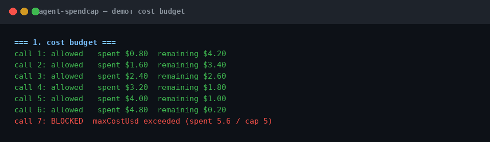
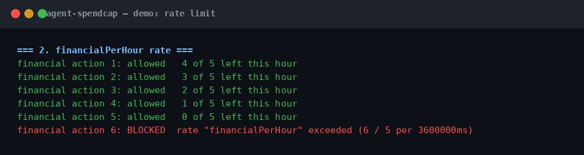

# agent-spendcap

[](https://github.com/richardsondx/agent-spendcap/actions/workflows/ci.yml)
[](LICENSE)

Budgets and semantic rate limits for AI agents. Zero dependencies.

## The problem

- AI agents consume tokens, money, API calls, and real-world side effects every time they act.
- One misconfigured loop or one poisoned tool description can burn through budget overnight.
- Per-request rate limits do not capture "5 refunds per hour" or "$50 per task".
- agent-spendcap gives each agent scope a cost cap, a tool-call cap, an external-write cap, and named sliding-window rate limits, checked before every action and recorded after.

## How it works (30 seconds)

```
Agent proposes action
        |
        v
spendcap.check({ kind, costUsd }) -- allowed? no --> onExhausted(reason) -> stop / escalate
        | yes
        v
   execute the action
        |
        v
spendcap.record({ kind, costUsd }) -> counters update, JSONL audit line appended
```

`check()` is pure: it never mutates state. `record()` mutates counters and fires `onExhausted` at most once per dimension per reset.

## Install

```sh
npm i agent-spendcap
```

## Quickstart (10 lines)

```ts
import { createBudget } from "agent-spendcap";

const budget = createBudget({ maxCostUsd: 5, maxToolCalls: 50, rates: { refundsPerHour: 5 } });

const r = budget.check({ kind: "tool", costUsd: 0.02 });
if (!r.allowed) throw new Error(r.reason); // "maxCostUsd exceeded (spent 5.02 / cap 5)"
// ... run the tool ...
budget.record({ kind: "tool", costUsd: 0.02 });
```

Run the demo: `npx tsx demo/demo.ts`

## Where it fits

Pair it with [callgate](https://github.com/richardsondx/callgate): the gate decides whether an agent SHOULD act, the cap decides HOW MUCH it may spend doing it. The pattern is check-before/record-after around every tool call. It also works standalone: wrap any agent loop with a budget and get spend protection with no policy engine.

## Screenshots





## API reference

`createBudget(config)` returns `{ check, record, snapshot, reset }`.

Config: `maxCostUsd?`, `maxToolCalls?`, `maxExternalWrites?`, `rates?` (name to max events per window, e.g. `{ refundsPerHour: 5 }`), `rateWindowMs?` (default 3,600,000), `scope?` (default `"default"`), `onExhausted?` (fires at most once per dimension per `reset()`), `logJsonl?` (append-only audit path), `now?` (injectable clock for tests).

`check({ kind, costUsd?, rateKeys? })` returns `{ allowed, reason?, remaining }`. Kinds: `"tool"`, `"financial"`, `"email"`, `"external-write"`. Only `kind === "external-write"` counts toward the external-write cap; gate `"financial"` and `"email"` with named rates instead. Unconfigured dimensions report `Infinity` remaining.

`record(usage)` updates counters, pushes rate timestamps, appends `{ ts, scope, kind, costUsd, rateKeys }` to the JSONL log, and fires `onExhausted` for newly exhausted dimensions.

`snapshot()` returns `{ spent, remaining, scope }`. `reset()` zeroes counters and clears fired flags; the JSONL log is append-only and is never cleared.

## For AI agents

- `llms.txt` at the repo root: install, quickstart, and API summary in agent-readable form.
- `skills/agent-spendcap/SKILL.md`: a Claude Code / Codex skill. When your agent needs spend protection, load the skill and follow it.

## License

MIT
